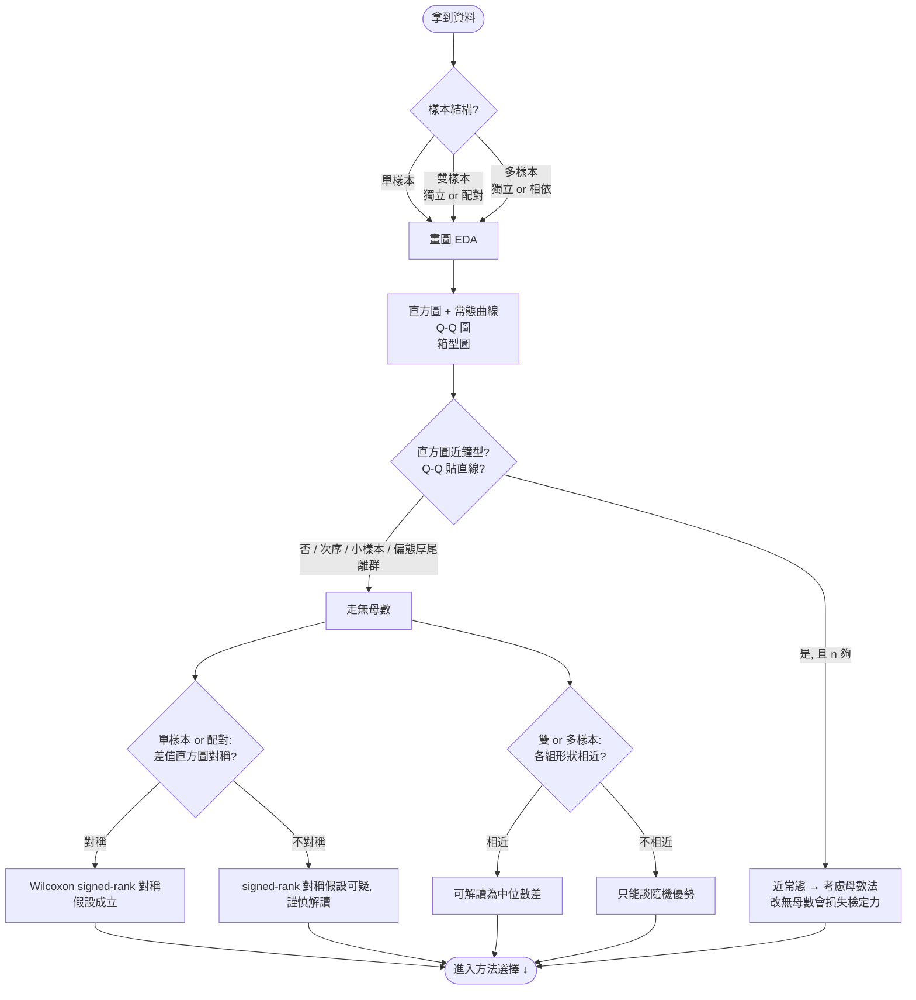
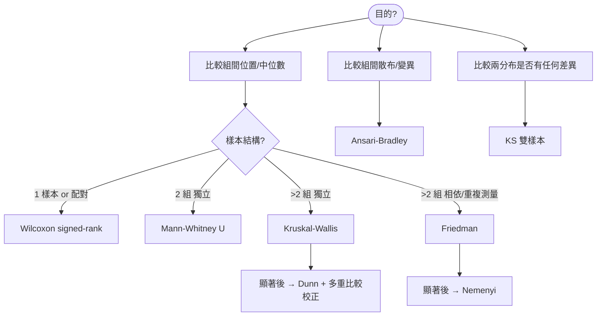

# Phase 0：理解資料與圖形檢查假設（選方法前必做）

選任何檢定**之前**，先認識資料：確定樣本模式，並用圖形檢查理論假設在這份資料上是否站得住。
這一步的結論（要不要走無母數、signed-rank 的對稱是否成立、組間形狀是否相近）會帶進下面的方法決策樹。

> **順序與限制（對齊 SKILL.md 的「行為限制」）**：匯入資料時先用文字描述資料、
> **詢問使用者要不要畫散布圖**（同意才畫），並問清目的；下面的直方圖 / Q-Q / 箱型圖等
> **診斷圖，要等使用者說明目的、選定方法後才畫**。任何圖都先問過再畫，未經同意不跑檢定。

## Phase 0 圖形 ↔ 檢查什麼 ↔ 影響哪個方法

| 圖形 | 檢查的假設 | 影響 |
|---|---|---|
| 直方圖 + 常態曲線 / Q-Q 圖 | 常態性（是否鐘型、Q-Q 是否貼直線） | 近常態且 n 夠 → 考慮母數；明顯非常態 → 無母數 |
| 配對差值 / 單樣本直方圖 | 對稱性 | 對稱 → Wilcoxon signed-rank 可用；不對稱 → 謹慎 |
| 箱型圖 / 各組直方圖 | 兩/多組形狀是否相近 | 相近 → Mann-Whitney / Kruskal-Wallis 可解讀中位數差；否則只談隨機優勢 |

> 畫圖用 `scripts/run_test.py plot`（`--kind hist` 畫直方圖+常態曲線+Q-Q）。

---

# 無母數方法選擇決策樹

> 承 Phase 0：已知樣本結構、且已用圖形確認要走無母數（次序或連續但非常態）後，依「目的」選方法。
> 本樹只做**結構性選擇**（目的 → 樣本結構 → 方法）；假設檢查與解讀界線見下方「解讀註記」，不畫成分岔。
> 範圍只含本專案 slides 的 6 個方法；名目資料、相關、適合度、隨機性等不在本 skill 範圍。

## 節點判斷規則（結構性）

| 判斷點 | 問法 | 分支 |
|---|---|---|
| 目的 | 想回答什麼問題? | 比較位置/中位數 / 比較散布 / 比較兩分布整體差異 |
| 樣本結構 | 幾組?同一批受試者還是獨立? | 1 或配對 / 2 獨立 / >2 獨立 / >2 相依 |

> 前提：反應變數為次序或連續但非常態（已於 Phase 0 確認）。

## 解讀註記（不是選方法的分岔，是選完後怎麼講）

| 方法 | 假設 / 解讀界線 |
|---|---|
| Wilcoxon signed-rank | 假設配對差值**對稱**（Phase 0 檢查）；不對稱時結論謹慎。 |
| Mann-Whitney U | 兩組**形狀相近**才可解讀為「中位數差」；否則只能談隨機優勢 P(X<Y)。 |
| Ansari-Bradley | 需**兩組中位數相等**，檢定才只反映散布差異。 |
| Kruskal-Wallis | 顯著後用 Dunn's test + Bonferroni/Holm 事後比較。 |
| Friedman | 顯著後用 Nemenyi 事後比較。 |
| KS 雙樣本 | 偵測兩分布**任何**差異（位置＋形狀），天生雙尾，不單指中位數。 |

## 方法對照（母數 ↔ 無母數）

| 情境 | 母數方法 | 無母數對應 |
|---|---|---|
| 單樣本/配對 | paired t-test | Wilcoxon signed-rank |
| 兩獨立樣本(位置) | independent t-test | Mann-Whitney U |
| 兩獨立樣本(散布) | F-test / Levene | Ansari-Bradley |
| 兩分布整體差異 | — | KS 雙樣本 |
| 多組獨立 | one-way ANOVA | Kruskal-Wallis |
| 多組相依 | repeated-measures ANOVA | Friedman |

> 每個方法的完整假設、統計量、ties 處理、判斷規則與 R code 見 `textbook-methods.md`。
