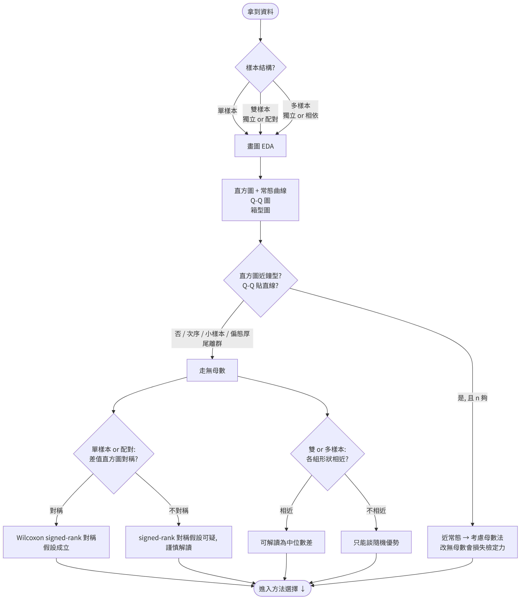
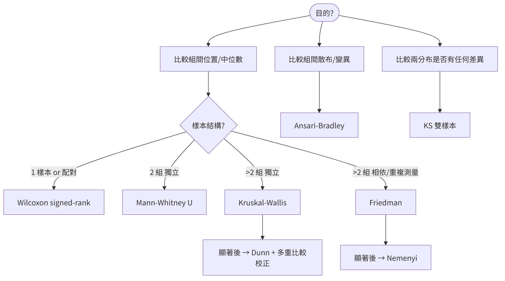

# File Structure

## File Structure

The skill uses **progressive disclosure**: a lightweight main file that is always
loaded, detailed knowledge split under `references/`, and computation delegated
to `scripts/`.

```text
nonparametric-stats-skill/
├── SKILL.md                    <- main file: behavior & workflow
├── references/
│   ├── methods.md              <- quick reference (scipy + effect sizes)
│   ├── textbook-methods.md     <- textbook detail (assumptions, formulas)
│   └── decision-tree.md        <- method-selection tree (Phase 0 + main tree)
└── scripts/
    └── run_test.py             <- actual computation + plotting
```

- **SKILL.md** — always loaded; controls *how the agent behaves*.
- **references/** — looked up on demand; holds the *knowledge*.
- **scripts/** — run only when numbers must be computed or data plotted.

## One-line Summary

| File | Purpose |
|---|---|
| `SKILL.md` | Defines behavior, workflow, triggers (the brain) |
| `methods.md` | One-page cheat sheet for the 6 tests |
| `textbook-methods.md` | Full assumptions & formulas (deepest layer) |
| `decision-tree.md` | Helps pick *which test* to use |
| `run_test.py` | Actually computes (scipy) and plots (matplotlib) |

> Scope matches this project's `slides.qmd` (based on Hollander, Wolfe &
> Chicken, 2015): **6 methods**.

# SKILL.md

## SKILL.md — the Brain

**What it does:** defines the skill's trigger conditions, scope, and the agent's
**behavior and answering workflow**. Editing this file changes how the agent acts.

- **Behavior guardrails (top priority):**
  - After data is imported, **ask before plotting** (even a scatter plot).
  - **Never run any test without explicit user consent.**
  - Do one step at a time, then stop and wait for the user.
- **Answering workflow:** clarify key points -> describe data & ask about a
  scatter plot -> select method (ask before running) -> assumptions & details ->
  effect sizes -> parametric vs. nonparametric trade-off.

> Core principle: always ask, never act on its own.

# methods.md

## methods.md — Quick-Reference Card

**What it does:** a one-page cheat sheet for the 6 methods, aimed at
**computation**.

Each method lists:

- Null hypothesis $H_0$
- Test statistic
- Handling of ties
- Effect size
- The matching **scipy function** (e.g. `scipy.stats.mannwhitneyu`)

> Use this to quickly look up "how is this test computed, which scipy function,
> what effect size."

# textbook-methods.md

## textbook-methods.md — Textbook-Level Detail

**What it does:** the deepest theoretical layer, extracted from `slides.qmd`.

Each method includes:

- Full assumptions (A1 / A2 / A3)
- Test statistic and derivation
- Tie-corrected variance formulas
- Exact decision rules and large-sample normal approximation
- R code

> Covers Wilcoxon signed-rank, Mann-Whitney, Ansari-Bradley, two-sample KS,
> Kruskal-Wallis, Friedman. The place for formulas and rigorous justification.

# decision-tree.md

## decision-tree.md — Phase 0: Understand the Data

Before choosing a method: fix the **sample structure**, then check assumptions
**graphically** (normality, symmetry, similar shape).

{height=72%}

## decision-tree.md — Method-Selection Tree

Structural branching: purpose -> sample structure -> method (6 methods only).

{height=70%}

# run_test.py

## run_test.py — Compute + Plot

**What it does:** SKILL.md requires "always run it, never compute by hand" — this
is the script that runs.

- **Tests** (scipy; returns statistic, p-value, effect size):
  - `mannwhitney`, `wilcoxon`, `kruskal`
- **Plotting** `plot` (matplotlib; saves PNG):
  - `scatter` — scatter plot
  - `box` — boxplot + jittered points
  - `paired` — before/after + difference distribution
  - `hist` — histogram + normal curve + Q-Q

```bash
python scripts/run_test.py plot --kind scatter --csv data.csv --x h --y w
python scripts/run_test.py mannwhitney --csv data.csv --value score --group grp
```

## Summary

- **Design:** progressive disclosure (light main file + layered references +
  computation script).
- **Behavior:** always ask; no plotting or testing without consent.
- **Scope:** aligned to the 6 nonparametric methods in `slides.qmd` — all four
  files and the script are consistent.
